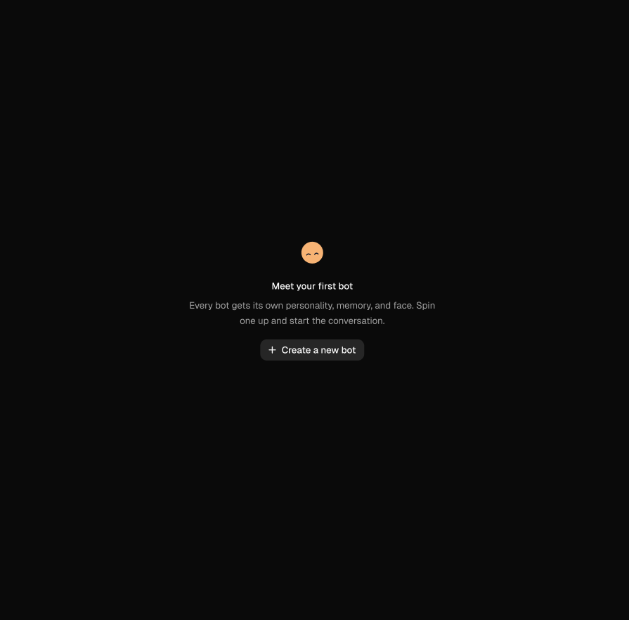
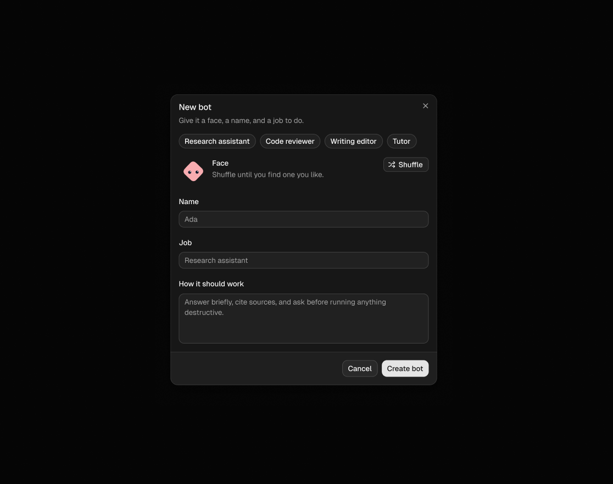
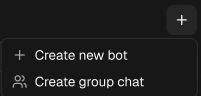
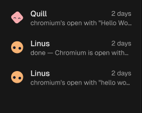
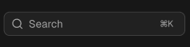
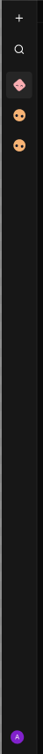
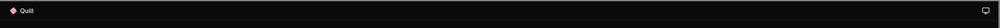
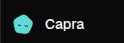

## Init Project

```
npx shadcn@latest init
    no monorepo
    Base Ui
    Nova
```

## Shadcn Skills

```
npx skills@latest add shadcn/ui
    Select : All Skills
    Agent : Claude Code 
    Installation scope : Project
    Installation method : Symlink
    Yes
``` 

* use shadcn skill to add available components
* Ensure '/home/shobhit/Mine/OmniBot/omnibot/app/layout.tsx' has all providers necessary to run added component 

## for Firecrawl CLI 
used for extracting the layout , styles of a website since claude webfetch tool does not work 

```
npx -y firecrawl-cli@latest init --all --browser
```

* use firecrawl to open x.ai/bot and tell me the exact color , fonts and button styles it uses
* use firecrawl to find all the companies building AI Agent TeamMates , summarize what are the most common features they offer 

## Clerk
npx skills@latest add clerk/skills

* Add authentication to this project using clerk skills

* keep .claude and .agents out of the build with a .dockerignore

* use clerk skill to claim this keyless project


## Neon for backend

    ```
        npm install -g neon@latest
        neon init
    ```

   for  Which region should the new project run in 
     select : ❯   AWS US East 1 (N. Virginia) (aws-us-east-1) -> it has object storage


    ```
        npx neon@latest skills -s neon -s neon-postgres -y
    ```

* Set up Drizzle ORM with Neon
* Add a simple todo list and push to database
* If you have done any migrations , remove all artifactes from it . Add a rule to @AGENTS.md to only perform database push and never migrations . Also remove migration scripts from package.json

    (because agent are natorious for backward compatability which is unnesscary in this devlopment)
* Add to @AGENTS.md 
    this is a devlopement project . There is no backward compatability and the data is worthless . Prefer data loss : never backfill migrate or preserve rows and never spend effort on keeping old data working , Every Scheme change means  a clean slate

* Replace everything in @db/schema.ts with a single "bots" table:
    id: nanoid primary key
    userId: required, indexed (third party id)
    name: required
    avatar: required, defaults to nanoid (seed for the bot's face)
    job: required (what the bot is for, in a phrase)
    instructions: optional (how it should go about the job)
    sandboxId: optional (third party id, created lazily later)
    createdAt: defaults to now

* Perform database push

## Figma

cwa.run/ai-team-figma

only logged in users should have access to the page 
* use clerk skills to protect @app/page.tsx

*  Replace @app/page.tsx content @components/ui/empty.tsx primitives composition to achieve look in the image attached .
for the avatar / empty media pick a random image from our project , like a logo or favicon - do not build one yourself .
use shadcn skills


## Avatar (https://www.dicebear.com/animated-avatars/)

go to 
https://www.dicebear.com/start/for-ai-assistants/

and 
paste this in AGENT.md
```
## DiceBear

Use DiceBear 10. Documentation: https://www.dicebear.com/llms.txt

There are seven native cores with identical output, not one library with
wrappers. Use the one matching this project's language. Do not reach for the
JavaScript core when the project is written in something else:

    JavaScript  @dicebear/core + @dicebear/styles
    PHP         dicebear/core + dicebear/styles
    Python      dicebear-core + dicebear-styles
    Rust        dicebear-core + dicebear-styles
    Go          github.com/dicebear/dicebear-go/v10 + github.com/dicebear/styles/v10
    Dart        dicebear_core + dicebear_styles
    C#          DiceBear.Core + DiceBear.Styles

Every style page carries a loading snippet for all seven, for example
https://www.dicebear.com/styles/lorelei/index.md

HTTP API: https://api.dicebear.com/10.x/<style>/svg?seed=<seed> The seed is a
query parameter, not a path segment. Options are query parameters too; array
values are separated by commas.

Options named after a component end in Variant: eyesVariant, not eyes. This
holds in all seven cores and in the HTTP API. Look up the options of a style at
https://api.dicebear.com/10.x/<style>/options.json

Write these forms, not the ones on the left. The left column is pre-10 and the
API does not reject it, so an outdated call runs and silently does the wrong
thing:

    avatars.dicebear.com/api/<style>/<seed>.svg  ->  api.dicebear.com/10.x/<style>/svg?seed=<seed>
    api.dicebear.com/9.x/<style>/svg             ->  api.dicebear.com/10.x/<style>/svg
    npm install @dicebear/collection             ->  npm install @dicebear/styles
    npm install @dicebear/lorelei                ->  npm install @dicebear/styles
    createAvatar(lorelei, { seed })              ->  new Avatar(new Style(definition), { seed })
    { eyes: ['variant01'] }                      ->  { eyesVariant: ['variant01'] }
    ?radius=50                                   ->  ?borderRadius=50

Only JavaScript and the HTTP API have a pre-10 form. The other six cores were
released in 2026 and never had one, so any older-looking PHP, Python, Rust, Go,
Dart or C# API attributed to DiceBear is invented rather than outdated.
```

* Create a ChatAvatar component in components/chat-avatar.tsx using DiceBear's gaze style. It takes a seed, an optional animated prop, and a className so callers can resize it, and renders a 32px next/image. Install whatever packages it needs.

* Replace @app/page.tsx EmptyMedia with @components/chat-avatar.tsx with different seed on every refresh

* 
    * Generate insert schema for bots table from @db/schema.ts using drizzle validation libraries
    * Develop createBot server action using the insert schema and clerk utils for userId (actions/bot.ts)
    * Develop a components/bot-dialog.tsx using @components/ui/dialog.tsx and form composition using react-hook-form and zod to match the image attached.
    * Wire up the bot-dialog to @app/page.tsx create bot button.
    * Use shadcn skill, neon skill, clerk skill.

* update @AGENTS.md with rules on how to develop form based on this conversation


* Add a "chats" table, a "chatMembers" join table, and relations to @db/schema.ts
    **chats:**
    * **id:** nanoid primary key
    * **userId:** required, indexed (Clerk user ID)
    * **kind:** required enum of "direct" or "group", defaults to "direct"
    * **name:** optional (null for direct chats, which use the bot's name)
    * **lastMessagePreview:** optional
    * **lastMessageAt:** required, defaults to now
    * **createdAt:** defaults to now

    **chatMembers:**
    * **chatId:** required, references chats, cascade on delete
    * **botId:** required, indexed, references bots, cascade on delete
    * **joinedAt:** defaults to now
    * primary key on chatId and botId together

     **relations:**
    * a bot has many memberships
    * a chat has many members
    * a chat member has one chat and one bot


* add a "chats" table, a "chatMembers" join table and relations to @db/schema.ts

* Modify @actions/bot.ts to batch create a new bot, new direct chat, and chat member

* Find and remove the header that renders sign in , sign up and user button when logged in

* Move @app/page.tsx to a new (dashboard) route group.
    * Add a new layout to (dashboard).
    * Register a sidebar provider inside the new layout.
    * Develop a completely empty @components/ui/sidebar.tsx inside a new components/app-sidebar.tsx
    * Register the new app-sidebar inside layout inside sidebar provider
    * use shadcn skill

* Render Clerk's UserButton component inside `@components/app-sidebar.tsx` footer.
    * Display both avatar and user name in the UserButton.
    * Render the UserButton as a `SidebarMenuButton` and use `UserButton` appearance prop to match the design and spacing of other sidebar menu items and buttons.

* Turn off @next.config.ts dev indicators
* The clickable area of the user button should be the full spacing of the sidebar menu element , not just user button and also have hover effect same as if this were a regular sidebar menu item + button . change the user buttom avatar size to 1.5rem

* 
    * Add a sidebar header to `@components/app-sidebar.tsx`
    * It should be a justify-end plus icon button that opens a `@components/ui/dropdown-menu.tsx`
    * It should be a ghost variant, so only when hovered should it's bg be visible
    * Create a new bot should open `@components/bot-dialog.tsx`
    * Create a group chat shouldn't open anything.

* 
    * Add a list of user's chats inside a sidebar group inside a sidebar content in `@components/app-sidebar.tsx`
    * Use the shadcn skill for proper sidebar menu item composition.
    * Instead of icon, use `@components/chat-avatar.tsx` for each chat's respective bot (ignore group chat kind for now, fallback to first bot)
    * Develop a queries/bots.ts query for this. Make sure to scope it to clerk's userId (use clerk skill)
    * Add date-fns package for any date string manipulation.

* 
    * Add a search button to `@components/app-sidebar.tsx` header, below the create menu button.
    * The search button should visually appear as the `@components/ui/input.tsx`, so copy its default classes to this search button, but keep the default hover effect of the button.
    * The button should open a `@components/ui/command.tsx` dialog that renders a list of user's chats with `@components/chat-avatar.tsx`, same as in the sidebar content (ignore group chats for now, simply render the first bot's avatar)
    * The command dialog should also be opened via cmd / control + k, use built-in shadcn components for the keyboard shortcut effect.
    use shadcn skill

* Selecting a chat from the command dialog should redirect to `chats/:chatId`
    * Same as clicking on the sidebar menu items.
    * Right now `chats/:chatId` does not exist - leave it like that.

* 
    * Enable collapsed icon mode to `@components/app-sidebar.tsx`. Collapsing should be done using sidebar rail.
    * Each section from the expanded sidebar should be visible in the collapsed mode.
    * Each button in the collapsed mode should be the same size.
    Use shadcn skill

* the search button has a visibly different varaint than the other buttons when in collasped mode 
* Persist sidebar state with a cookie . (not change to open sidebar in every refresh)

* Register a chats/:chatId page inside @app/(dashboard). Render the current chatId in a paragraph, nothing more

* 
    * Develop chat get query in `queries/chat.ts`, scope it to clerk's user Id (clerk skill)
    * Load the chat by it's id in `@app/(dashboard)/chats/[chatId]/page.tsx`
    * Develop a `components/chat-header.tsx` according to the screenshot, use `@components/chat-avatar.tsx` to display this chat's bot's avatar (ignore group chats for now, simply use the first chat member's information).
    * The desktop button on the right end of the chat header shouldn't do anything.

* 
    * there is avatar with the chat name in the chat header (like the given image) , make them a button by grouping them together that opens an edit / update version of @components/bot-dialog.tsx . Adhere to form creation rules .  
    * make a delete button in this new edit dailog with confirmation before delete

## AI Elements (https://elements.ai-sdk.dev/)
premitive components built on top of shadcn ui making it compatiable with our exisiting components and it is also deeply integrated with ai-sdk (used to communicate with ai providers)

```
npx ai-elements@latest
```

```
npx skills@latest add vercel/ai-elements
```

```
npm install ai @ai-sdk/react zod
```

```
npm skills@latest add vercel/ai
```